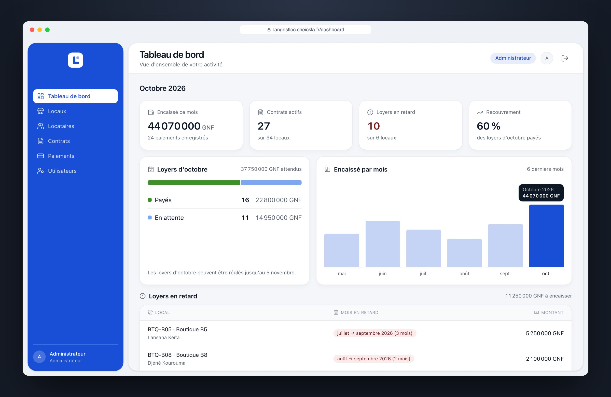
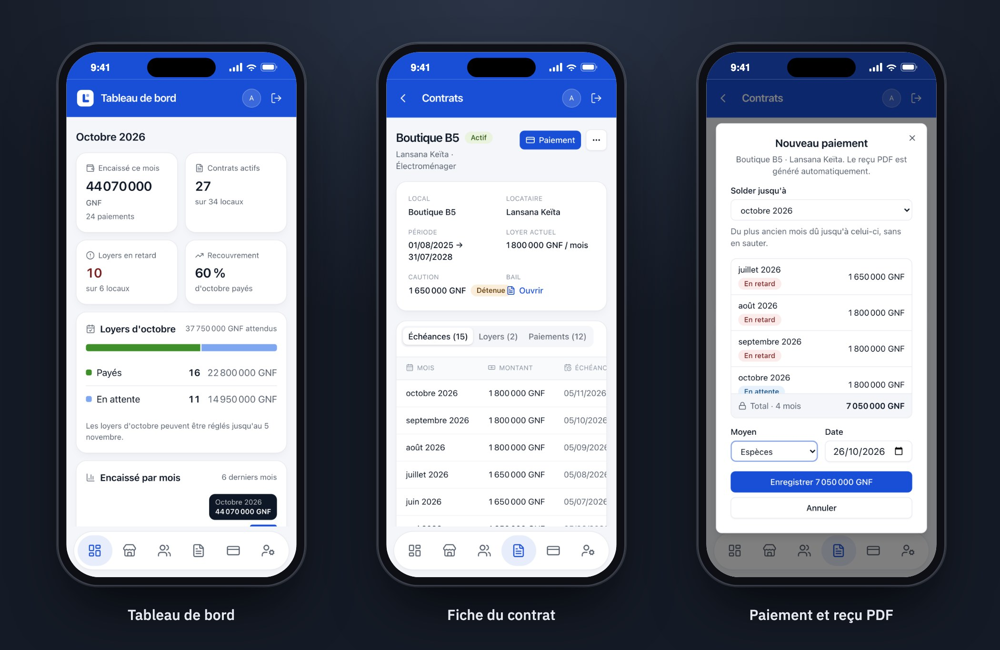

# LanGestLoc

Application de gestion locative pour un parc de locaux commerciaux en Guinée.

Jusqu'ici, le propriétaire gérait tout son parc sur papier. Il voulait en sortir, automatiser le suivi et ne plus perdre la trace d'aucune opération. Avec LanGestLoc :

- chaque bail est généré en PDF à la création du contrat, prêt à imprimer ou à envoyer ;
- chaque loyer encaissé est enregistré, avec sa date, son moyen de paiement (espèces, Orange Money, Mobile Money) et un reçu PDF à remettre au locataire ;
- les échéances se créent seules chaque mois, et les retards ressortent d'eux-mêmes ;
- le tableau de bord montre d'un coup d'œil ce qui est encaissé, ce qui reste dû et qui est en retard ;
- l'historique est complet : un paiement ou un reçu enregistré ne se modifie pas et ne s'efface pas ;
- un agent peut encaisser les loyers depuis son téléphone, sans pouvoir toucher aux contrats.

**En production : [langestloc.cheickla.fr](https://langestloc.cheickla.fr)**



Elle s'utilise surtout sur téléphone, et tout aussi bien sur ordinateur. Sur téléphone, c'est une PWA : elle s'installe sur l'écran d'accueil et s'ouvre en plein écran.



<sub>Captures faites avec des données fictives.</sub>

## Architecture

- **Front** : Next.js 16 (App Router), React 19, TypeScript, Tailwind v4, shadcn/ui (Radix UI), icônes Lucide, notifications Sonner, TanStack Query, react-hook-form et Zod. PWA installable. Lectures en Server Components, formulaires et paiements en Client Components.
- **Back** : API REST en NestJS 11 et TypeScript, avec Prisma 7, authentification JWT (Passport, stratégies local et JWT), validation des entrées (class-validator et class-transformer), configuration par variables d'environnement (@nestjs/config), limitation de débit (@nestjs/throttler), tâches planifiées (@nestjs/schedule) et documentation Swagger.
- **Base de données** : PostgreSQL 16, migrations Prisma.
- **Documents** : bail et reçus générés en PDF avec PDFKit, aux couleurs de l'appli, puis stockés sur AWS S3 (AWS SDK v3). L'envoi sur S3 se fait après l'enregistrement en base, jamais pendant.
- **Conteneurs** : Docker, avec Docker Compose en local comme en production.
- **Types partagés** : les types du front sont générés depuis la spec OpenAPI de l'API (openapi-typescript). Aucune réponse de l'API n'est typée à la main.

## Sécurité

- Le navigateur ne parle jamais à l'API : Next la relaie côté serveur. Le jeton JWT reste dans un cookie httpOnly, hors de portée du JavaScript, et il n'y a pas de CORS à ouvrir.
- Mots de passe hachés avec bcrypt.
- Les rôles sont vérifiés par l'API sur chaque route (guards Passport), pas seulement masqués dans l'interface.
- Limitation de débit : 100 requêtes par minute par utilisateur et par route, et 5 tentatives de connexion par minute par adresse e-mail.
- Swagger est désactivé en production.
- Serveur : connexion SSH par clé uniquement, pare-feu limité aux ports 22, 80 et 443, HTTPS automatique avec Caddy.

## Tests et qualité

- Environ 390 tests unitaires côté API (Jest), et des tests Vitest côté front.
- Un scénario de bout en bout tourne en CI : l'API démarre sur une vraie base PostgreSQL et un stockage S3, puis le script parcourt tout le cycle (contrat, échéances, paiements, reçus, résiliation, annulation) en vérifiant les codes de réponse et les règles métier.
- Chaque PR passe le lint (ESLint, Prettier), le build et les tests. Le merge est bloqué si le CI échoue.

## Déploiement et sauvegardes

- Un merge sur `main` déploie tout, sans commande manuelle. GitHub Actions publie l'image sur GHCR et la déploie par SSH sur un VPS OVH (Docker Compose, Caddy) : sauvegarde de la base, migrations, bascule, puis retour arrière automatique avec restauration si quelque chose échoue.
- Le front est sur Vercel, et n'est mis en ligne qu'une fois le CI passé.
- La base est sauvegardée chaque nuit, chiffrée avec age, sur S3. Une restauration est testée automatiquement chaque lundi.
- Toute modification du déploiement est d'abord répétée dans Docker, en local et en PR.

Procédures détaillées : [deploy/README.md](deploy/README.md).

## Lancer en local

Il faut Docker, Node.js (npm) et un fichier `.env` à la racine (base, JWT, S3, comptes du seed).

```sh
docker compose up        # Postgres, stockage S3 local (RustFS) et API sur le port 3000
cd frontend && npm install && npm run dev   # front sur le port 3001
```

Prisma Studio : `cd backend && npx prisma studio`. Il lit `DATABASE_URL` dans `backend/.env`, pas dans le `.env` de la racine : la base y est sur `localhost:5432`.
